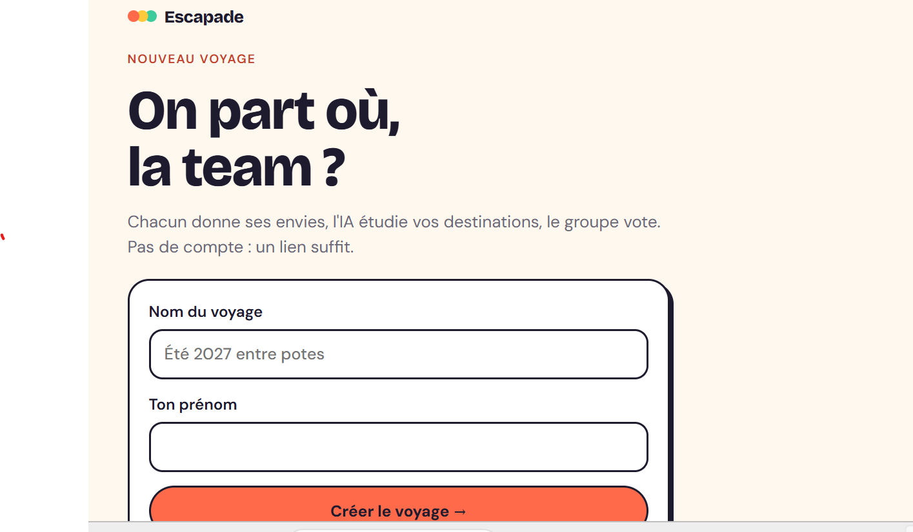
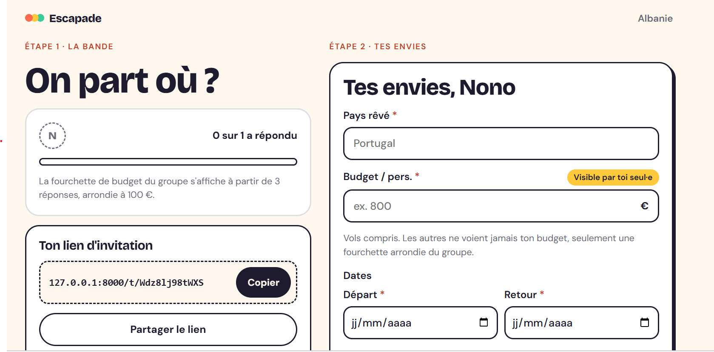
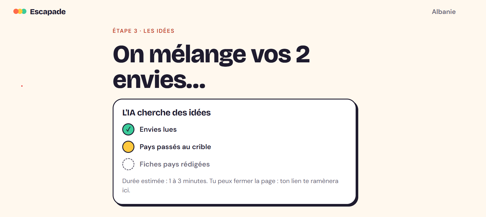
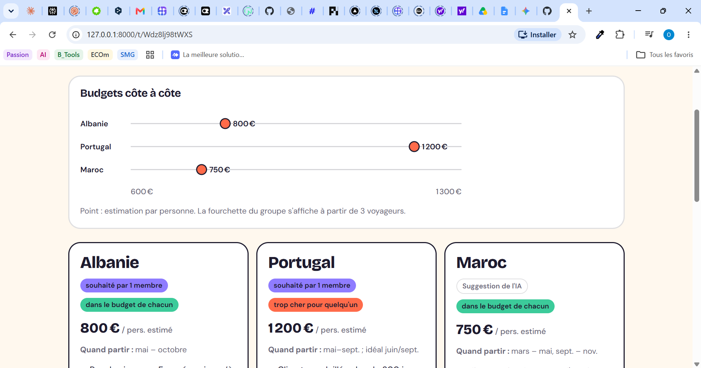

# Escapade — agent de voyage de groupe (LangGraph)

Chacun donne ses envies (pays rêvé, budget privé, dates, style, ville de départ). L'IA présente une fiche
par pays rêvé et complète par ses propres idées jusqu'à trois pays. Le groupe vote, puis l'agent planifie le
voyage : vols, hébergement, itinéraire jour par jour et budget détaillé (dépenses sur place comprises). Utilisable depuis un **site web responsif installable (PWA)** ou en **ligne de
commande**.

- Architecture, conventions, règles de confidentialité : [`CLAUDE.md`](CLAUDE.md)
- Diagramme : [`diagrams.drawio`](diagrams.drawio) · Suivi : [`TICKETS.md`](TICKETS.md)
- Design du site : [`design/Escapade Directions.dc.html`](design/) (direction « Confetti »)

## Comment ça marche (pour les voyageurs)

Escapade aide un groupe d'amis ou une famille à choisir **où** partir, puis à organiser **comment** y aller,
sans tableur ni discussion interminable.

1. **Créer le voyage.** Une personne, l'organisateur·rice, crée le voyage et partage le lien avec le groupe.
   Pas de compte ni de mot de passe : chaque membre est reconnu par son navigateur.
2. **Donner ses envies.** Chaque membre indique son pays rêvé, ses dates, sa ville de départ, son style de
   voyage (aventure, détente, culture…) et son budget. **Le budget reste privé** : personne d'autre ne le
   voit, pas même l'organisateur·rice. Le groupe ne voit qu'une fourchette arrondie, et seulement à partir de
   trois réponses.
3. **Lancer l'IA.** Quand tout le monde a répondu (ou sans attendre les retardataires), l'organisateur·rice
   lance l'IA. En une à trois minutes, elle étudie chaque destination : climat, coût, visa, sécurité.
4. **Découvrir les pays.** Une fiche par pays rêvé par le groupe, complétée par des suggestions de l'IA
   jusqu'à trois pays. Chaque fiche donne les points forts, les points faibles, un budget estimé et la
   meilleure période. Un badge indique combien de membres ont rêvé de ce pays (sans dire qui), ou s'il s'agit
   d'une idée de l'IA. Aucune fiche ne plaît ? L'organisateur·rice demande **d'autres idées**, avec un mot
   sur ce que le groupe cherche.
5. **Voter.** Chacun vote en secret pour son pays préféré. Le vote se clôt quand tout le monde a voté, ou
   plus tôt si l'organisateur·rice le décide. En cas d'égalité, c'est l'organisateur·rice qui tranche.
6. **Recevoir le plan.** L'IA choisit une ville de séjour dans le pays gagnant, puis prépare le voyage : prix
   des vols depuis la ville de chacun, hôtel, programme jour par jour et dépenses sur place (transports,
   repas, activités). Elle vérifie que le total tient dans le budget du groupe et recommence jusqu'à deux fois
   si ce n'est pas le cas. Chacun voit sa propre part et si elle tient dans son budget.
7. **Ajuster (si la relecture est activée).** L'organisateur·rice relit le brouillon et peut le valider,
   demander un ajustement en quelques mots (« plutôt Porto, avec piscine ») ou, si le plan dépasse le budget,
   cocher des **pistes d'économie chiffrées** : dépenses sur place en mode économique, hôtel plus simple.
8. **Garder un souvenir.** Une fois le plan validé, le bouton « Télécharger le carnet (PDF) » produit un
   carnet de voyage à imprimer ou à partager, sans aucun budget individuel.

Envie d'être prévenu·e sans garder la page ouverte ? Le bouton « Me prévenir » envoie une notification quand
les idées ou le plan sont prêts. Le site s'installe aussi comme une application sur le téléphone (voir
ci-dessous).


## Prérequis

- Python ≥ 3.11 et [uv](https://docs.astral.sh/uv/)
- Clés d'API : [OpenRouter](https://openrouter.ai) (LLM) et [Tavily](https://tavily.com) (recherche web).
  [SerpApi](https://serpapi.com) (prix des vols Google Flights) est facultatif : sans clé, les vols sont factices.

## Installation

```bash
uv sync --extra dev
cp .env.example .env   # puis renseigner les clés
```

| Variable | Rôle |
|---|---|
| `OPENROUTER_API_KEY`, `OPENROUTER_MODEL` | LLM (modèle `:free` conseillé) |
| `TAVILY_API_KEY` | Recherche web (pays, hôtels, activités) |
| `SERPAPI_API_KEY` | Prix des vols ; vide = vols factices. Plan gratuit : 250 recherches / mois, ~1 par voyageur et par plan |
| `SQLITE_PATH` | Fichier SQLite (checkpoints de l'agent + voyages du site) |
| `ENABLE_FINAL_HITL` | `true` : l'organisateur relit et valide le plan avant qu'il soit définitif |
| `WEB_HOST`, `WEB_PORT`, `WEB_SECURE_COOKIES` | Serveur web (défaut `127.0.0.1:8000`) ; cookies `Secure` derrière HTTPS |
| `LANGSMITH_TRACING`, `LANGSMITH_API_KEY`, `LANGSMITH_PROJECT` | Traces LangSmith (optionnel). Les budgets y sont masqués ; `LANGSMITH_REDACT_BUDGETS=false` pour les voir en local |
| `VAPID_PUBLIC_KEY`, `VAPID_PRIVATE_KEY`, `VAPID_SUBJECT` | Notifications push (optionnel, voir plus bas) ; vide = désactivées |
| `PORT`, `WEB_FORWARDED_ALLOW_IPS` | Hébergement : port imposé par la plateforme (prioritaire sur `WEB_PORT`) ; proxys dont on accepte `X-Forwarded-For` (défaut `127.0.0.1`) |

Ne jamais committer `.env` ni le fichier SQLite (déjà dans `.gitignore`).

## Lancer le site web

```bash
uv run travel-web
```

Puis ouvrir <http://127.0.0.1:8000>, créer un voyage et partager le lien `/t/{code}` avec le groupe. Pas de
compte : chaque membre est reconnu par un cookie de son navigateur.

Parcours : envies → l'organisateur lance l'IA (1 à 3 min) → une fiche par pays rêvé (complétée par l'IA jusqu'à 3) → vote secret → plan (1 à 3 min) → relecture par l'organisateur si `ENABLE_FINAL_HITL=true` (ajustement, pistes d'économie) → carnet PDF du plan validé.

**Installer l'application (PWA)** : Chrome / Edge proposent l'installation dans la barre d'adresse ; sur
iPhone, « Partager » puis « Sur l'écran d'accueil ». Hors `localhost`, l'installation et le mode hors ligne
exigent HTTPS.

## Notifications push (optionnel)

Pour prévenir le groupe quand les idées ou le plan sont prêts :

```bash
uv run travel-vapid   # affiche VAPID_PUBLIC_KEY, VAPID_PRIVATE_KEY et VAPID_SUBJECT à copier dans .env
```

Les clés se génèrent **une seule fois** : en changer invalide les abonnements existants. Chaque membre active
les notifications avec « Me prévenir » sur la page du voyage. Elles marchent sur `localhost` et en HTTPS ;
sur iPhone, il faut iOS 16.4+ et le site ajouté à l'écran d'accueil.

## Déploiement (Render)

Le dépôt contient un `Dockerfile` et un blueprint `render.yaml` : service web Docker, une seule instance,
disque persistant de 1 Go sur `/data`, vérification de santé sur `/api/health`.

1. Sur Render : **New → Blueprint**, choisir ce dépôt. Render lit `render.yaml`.
2. **Variables** : Render demande les valeurs marquées `sync: false` (`OPENROUTER_API_KEY`,
   `OPENROUTER_MODEL`, `TAVILY_API_KEY`, `SERPAPI_API_KEY`, LangSmith, `VAPID_*`). Laisser vide ce qui ne
   sert pas ; `LANGSMITH_TRACING` et `ENABLE_FINAL_HITL` se changent ensuite dans *Environment*. L'image fixe
   déjà `WEB_HOST=0.0.0.0`, `WEB_SECURE_COOKIES=true`, `WEB_FORWARDED_ALLOW_IPS=*` et
   `SQLITE_PATH=/data/checkpoints.sqlite` ; Render fournit `PORT`.
3. **Offre** : le disque exige une offre payante (`starter` dans le blueprint). L'offre gratuite n'a pas de
   disque (voyages perdus à chaque redémarrage) et met le service en veille après 15 min sans visite, ce
   qui coupe les générations en cours.
4. URL en HTTPS `*.onrender.com`, ou un domaine à soi dans *Settings → Custom Domains*.

À savoir :

- **Une seule instance**, jamais de mise à l'échelle horizontale : SQLite et le verrou de `TripRepository`.
- **Un déploiement coupe les générations en cours** : le voyage passe en erreur et l'organisateur le
  relance avec « Réessayer » (reprise au dernier checkpoint). Éviter de déployer pendant qu'un groupe génère.
- **Limites d'usage (T59)** : à mettre en place avant de partager un lien public, sinon n'importe qui peut
  consommer les quotas SerpApi et OpenRouter.
- **Sauvegarde** : le disque contient tout (voyages et checkpoints) ; Render en prend un instantané
  quotidien, restaurable depuis l'onglet *Disks*.

## Ligne de commande

```bash
uv run python -m travel_agent.main
```

Saisie des envies de chaque voyageur, choix du pays et validation du plan dans le terminal.

## Tests

```bash
uv run pytest
```

Les tests n'appellent aucun service externe (LLM, Tavily et SerpApi sont simulés), y compris quand
`.env` contient de vraies clés. Ce que seul un navigateur montre est décrit dans
[`docs/checklist-navigateur.md`](docs/checklist-navigateur.md).

## Évaluations du LLM

```bash
uv run python -m evals.run            # vrai LLM, nœud par nœud ; voir evals/README.md
```

Contrairement aux tests, les évaluations appellent le vrai modèle (et Tavily, mis en cache) pour mesurer la
qualité de ses réponses. SerpApi n'est jamais appelé.

## Structure

```
travel_agent/
├── graph.py, state.py, llm.py   # graphe parent, état, client OpenRouter
├── tracing.py                   # traces LangSmith, budgets masqués
├── subgraphs/                   # Graph 1 (suggestion de pays), Graph 2 (planification, dépenses sur place)
├── guardrails/                  # entrée (validation, injection, PII), contrôle du brouillon (dates, budget), sortie (schéma, URLs)
├── tools/                       # Tavily, vols (SerpApi / factices), résolution des aéroports
├── web/                         # API FastAPI, runner de l'agent, vues, notifications push, front PWA (static/)
└── main.py                      # CLI
tests/                           # unitaires, API, parcours complet (test_e2e.py)
evals/                           # évaluations du vrai LLM nœud par nœud
docs/checklist-navigateur.md
```


## Screenshot











